# JARVIS System Architecture

## 1. Architectural Philosophy

JARVIS is designed as a **modular monolithic personal desktop AI agent** optimized for Windows 11 on moderate hardware (Intel Core i5-6300U, 16 GB RAM). To avoid exhausting local hardware resources with large parameter models or heavy CV pipelines, JARVIS utilizes cloud-based Google Gemini APIs for deep reasoning, multimodal comprehension, and execution planning.

The architecture emphasizes:
1. **Clear Separation of Concerns:** UI, orchestration, AI provider, tools, permissions, and storage are isolated through explicit abstract interfaces.
2. **Non-Blocking Background Execution:** Network and streaming operations run strictly inside dedicated `QThread` workers, ensuring the Qt GUI event loop is never blocked.
3. **Strict Default-Deny Security:** No tool or action may execute without explicit verification through the permission system.
4. **Resilience & Graceful Degradation:** The application functions deterministically even when cloud connectivity or API keys are unavailable.
5. **Lightweight Native UI:** Built with PySide6 (Qt 6) with no webview/electron overhead, keeping memory and CPU utilization minimal.

---

## 2. Core Subsystems & Responsibilities

```mermaid
flowchart TD
    App[app.py Entry Point] --> MainWindow[UI: MainWindow]
    App --> Agent[Core: JARVISAgent]
    
    subgraph UI Layer
        MainWindow --> ChatPanel[ChatPanel - English & Persian RTL]
        MainWindow --> StatusPanel[StatusPanel - Telemetry & State]
        MainWindow -. Spawns .-> StreamWorker[ui.workers: GeminiStreamWorker (QThread)]
        MainWindow -. Spawns .-> ConnWorker[ui.workers: ConnectionTestWorker (QThread)]
    end
    
    subgraph Core Orchestration
        Agent --> EventBus[EventBus]
        Agent --> TaskManager[TaskManager]
        Agent --> ToolRegistry[ToolRegistry]
        Agent --> PermManager[StrictDefaultDenyPermissionManager]
    end
    
    subgraph AI Provider Layer
        StreamWorker --> GeminiProvider[GeminiProvider / BaseAIProvider]
        ConnWorker --> GeminiProvider
        GeminiProvider --> GenAIClient[google.genai.Client]
    end
    
    subgraph Persistence Layer
        Agent --> SQLiteStore[SQLiteMemoryStore / BaseMemoryStore]
    end
    
    StreamWorker -. Qt Signals (chunks/finished) .-> ChatPanel
    ToolRegistry --> PermManager
    EventBus -. Events .-> MainWindow
```

### 2.1 Gemini Provider Architecture (`ai/providers/gemini.py`)
- **Official SDK Client:** Integrates `from google import genai` and `from google.genai import types, errors`.
- **Client Lifecycle:** Lazy initialization upon first authorized call. Client instances are recreated whenever settings are updated in the GUI.
- **Content Formatting (`_build_contents`):**
  - Converts local `ConversationMessage` history into SDK `types.Content(role='user'|'model', parts=[types.Part.from_text(...)])`.
  - Automatically omits cancelled, failed, or incomplete messages from prompt context.
  - Bounded to `settings.conversation_history_limit` to prevent context explosion.
- **Generation & Streaming:**
  - `generate_text(...)`: Unary generation with bounded exponential backoff retry for transient network/server failures (code 500, 503, dropped socket).
  - `stream_text(...)`: Generator yielding string chunks from `client.models.generate_content_stream`. Checks thread cancellation between chunks and raises `GeminiCancelledError` when cancelled by the user.
- **Categorized Connection Testing:** `test_connection()` executes a lightweight ping to the configured model and cleanly categorizes outcomes (`SUCCESS`, `MISSING_API_KEY`, `INVALID_API_KEY`, `AUTH_FAILURE`, `MODEL_NOT_FOUND`, `QUOTA_EXCEEDED`, `NETWORK_ERROR`, `TIMEOUT`, `SERVER_ERROR`).

### 2.2 Streaming & Background Worker Layer (`ui/workers.py`)
- **`GeminiStreamWorker(QThread)`:**
  - Carries `prompt`, `history`, `session_id`, and `CancellationToken`.
  - Runs network calls entirely off the main thread.
  - Emits Qt Signals:
    - `chunk_received(str)`: Carries incremental token chunk to the GUI.
    - `generation_finished(str, str)`: Carries full text and session ID.
    - `generation_error(str, str)`: Carries error description and session ID.
    - `generation_cancelled(str)`: Signals user cancellation.
- **`ConnectionTestWorker(QThread)`:** Runs provider connectivity diagnostics in the background so settings dialog buttons never freeze.

### 2.3 User Interface (`ui/`)
- Pure PySide6 implementation styled with a dark futuristic QSS stylesheet.
- **`ChatPanel`:**
  - Dynamic streaming updates: `start_assistant_streaming()`, `append_streaming_chunk()`, and `finish_assistant_streaming()`.
  - Action button changes from "Send" to "Cancel" during generation. Clicking "Cancel" signals the active stream worker to abort.
  - Direction detection: Dynamically assigns right-to-left alignment for Persian text and left-to-right alignment for English text.
  - Conversation controls: "+ New Chat" and "🗑 Clear" buttons.
- **`StatusPanel`:** Displays real-time agent state, host hardware specs, selected Gemini model, connectivity badge, and voice engine standby state.
- **`SettingsDialog`:** Password-masked API key field with show/hide toggle, model selection dropdown, generation parameter spinboxes (temperature, tokens, timeout), and atomic `.env` save mechanism.

### 2.4 Persistence Layer (`memory/`)
- `SQLiteMemoryStore`: Located at `data/jarvis.db` configured with WAL mode.
- Tables:
  - `sessions`: `(session_id, title, created_at, updated_at)`
  - `messages`: `(message_id, session_id, role, content, status, model, metadata, created_at)`
  - `preferences`: `(pref_key, pref_value, updated_at)`
- Records completion status (`completed`, `streaming`, `cancelled`, `failed`) and model identifier for every message.

---

## 3. Application Lifecycle & Data Flow

```
User types prompt
       │
       ▼
ChatPanel emits message_submitted
       │
       ▼
MainWindow records User message in SQLite (status='completed')
       │
       ▼
MainWindow starts assistant bubble (streaming mode)
MainWindow records Assistant message in SQLite (status='streaming')
       │
       ▼
MainWindow launches ProviderStreamWorker (QThread via ProviderManager)
       │
       ├──► chunk_received(chunk) ──► ChatPanel appends chunk & auto-scrolls
       │
       ├──► On completion ──────────► ChatPanel marks completed
       │                              SQLite updates message (status='completed')
       │
       └──► On cancel / error ─────► ChatPanel marks cancelled / error
                                      SQLite updates message (status='cancelled'/'failed')
```

---

## 4. Multi-Provider AI Architecture & Dual Fallback

Starting with Phase 2.2, JARVIS is completely provider-independent and extensible. The agent core and UI layer interact exclusively with abstract contracts defined in `ai/base.py`, mediated by `ProviderManager`.

### 4.1 Supported Initial Providers
1. **Google Gemini (`gemini`):** Official `google-genai` SDK with full streaming and 1M token context.
2. **OpenAI (`openai`):** Official `openai` SDK (`gpt-4o`, `gpt-4o-mini`, `o3-mini`).
3. **Anthropic Claude (`anthropic`):** Official `anthropic` SDK with Messages API (`claude-3-5-sonnet-20241022`, `claude-3-5-haiku-20241022`, `claude-3-opus-20240229`).
4. **DeepSeek (`deepseek`):** OpenAI-compatible high-performance reasoning endpoint at `https://api.deepseek.com` (`deepseek-chat`, `deepseek-reasoner`).
5. **OpenRouter (`openrouter`):** Universal gateway endpoint at `https://openrouter.ai/api/v1` with routing to open & proprietary models.
6. **Groq (`groq`):** Ultra-fast LPU inference endpoint at `https://api.groq.com/openai/v1` (`llama-3.3-70b-versatile`, `llama-3.1-8b-instant`).

### 4.2 Central Provider Registry & Model Catalog
- **`ProviderRegistry` (`ai/registry.py`):** Enables dynamic provider registration, lifecycle management, singleton caching, and capability lookup. Adding a new provider requires zero changes to the UI or Agent Core.
- **`ModelCatalog` (`ai/catalog.py`):** Explicitly catalogs models and verified capabilities (streaming, tool calling, structured outputs, vision, context window, and max output tokens).

### 4.3 Intelligent Dual Fallback
- **Automatic Fallback:** When enabled (`ENABLE_AUTO_FALLBACK=True`), if the primary provider encounters a retryable server error (HTTP 500, 502, 503, 504, 429 quota exhaustion, or network timeout), `ProviderManager` automatically routes the request to the next enabled and configured provider in the configured priority list (`FALLBACK_PROVIDER_ORDER`).
- **Non-Retryable Errors:** Permanent failures such as authentication errors (401 invalid key), permission denied (403), or user cancellation NEVER trigger fallback and raise safe, normalized exceptions directly.
- **Manual Fallback:** Users can switch providers globally or per conversation session, and retry failed messages on alternative providers.

### 4.4 Model-Specific Parameter Adaptation & Reasoning Models
- **OpenAI Reasoning (`o1`, `o3-mini`):** Automatically routes `max_completion_tokens` instead of `max_tokens`, omits `temperature` to avoid HTTP 400 errors, and converts system instructions into the `developer` role.
- **DeepSeek Reasoner (`deepseek-reasoner` / R1):** Automatically omits the `temperature` parameter to adhere strictly to DeepSeek reasoning endpoint specifications.
- **Dynamic Model Catalog Lifecycle:** Models carry explicit `lifecycle_status` (`active`, `preview`, `deprecated`, `retired`) and `verification_date`. Deprecated models (such as `mixtral-8x7b-32768`) are filtered by default while remaining queryable. Custom models can be registered at runtime via `ModelCatalog.register_custom_model`.

### 4.5 Cross-Provider Privacy Guard & Interrupted Stream Safety
- **Cross-Provider Privacy (`allow_cross_provider_history_transfer`):** By default (`False`), conversation history is never forwarded to alternative third-party vendors when automatic fallback triggers; only the immediate prompt is sent, preventing cross-vendor data exposure. Users may explicitly opt in via settings.
- **Scenario B Mid-Stream Interruption Safety:** If tokens have already streamed to the user interface and a network disconnect occurs mid-generation, `ProviderManager` will not trigger a silent secondary fallback (which would produce garbled, concatenated responses). The partial text is preserved in the UI bubble and visibly tagged as `⚠️ [Interrupted: {error}]` with an interactive Retry button.

---

## 5. Phase 3 Agent Core & Planning Architecture

Starting with Phase 3, JARVIS incorporates autonomous planning, deterministic state machine orchestration, and bounded tool execution.

### 5.1 Architecture Diagram

```mermaid
stateDiagram-v2
    [*] --> IDLE
    IDLE --> ANALYZING: Goal received
    IDLE --> PLANNING: Direct plan request
    IDLE --> EXECUTING: Direct execution
    IDLE --> CANCELLED: User abort

    ANALYZING --> PLANNING: Multi-step task detected
    ANALYZING --> EXECUTING: Single-turn conversational goal
    ANALYZING --> WAITING_FOR_INPUT: Clarification required
    ANALYZING --> COMPLETED: Immediate response available
    ANALYZING --> FAILED: Goal analysis error
    ANALYZING --> CANCELLED: Abort
    ANALYZING --> IDLE: Reset

    PLANNING --> PLAN_READY: Plan generated and validated
    PLANNING --> REPLANNING: Plan generation failed
    PLANNING --> WAITING_FOR_INPUT: Missing parameters
    PLANNING --> FAILED: Planning limits exceeded
    PLANNING --> CANCELLED: Abort
    PLANNING --> IDLE: Reset

    PLAN_READY --> EXECUTING: Execution started
    PLAN_READY --> WAITING_FOR_APPROVAL: First step requires approval
    PLAN_READY --> PLANNING: Re-planning needed
    PLAN_READY --> REPLANNING: Plan adjustments needed
    PLAN_READY --> FAILED: Validation failed
    PLAN_READY --> CANCELLED: Abort
    PLAN_READY --> IDLE: Reset

    EXECUTING --> EXECUTING: Step iteration
    EXECUTING --> WAITING_FOR_APPROVAL: High-risk tool proposal
    EXECUTING --> WAITING_FOR_INPUT: Tool requires user input
    EXECUTING --> REPLANNING: Step failure / loop detected
    EXECUTING --> COMPLETED: All steps finished successfully
    EXECUTING --> FAILED: Execution error / timeout / limit exceeded
    EXECUTING --> CANCELLED: User cancellation

    WAITING_FOR_APPROVAL --> EXECUTING: User approved proposal
    WAITING_FOR_APPROVAL --> REPLANNING: User rejected proposal
    WAITING_FOR_APPROVAL --> FAILED: Proposal expired / error
    WAITING_FOR_APPROVAL --> CANCELLED: Cancellation while waiting
    WAITING_FOR_APPROVAL --> IDLE: Reset

    WAITING_FOR_INPUT --> ANALYZING: Input received
    WAITING_FOR_INPUT --> PLANNING: Replanning with new input
    WAITING_FOR_INPUT --> EXECUTING: Resuming execution with input
    WAITING_FOR_INPUT --> FAILED: Input timeout / failure
    WAITING_FOR_INPUT --> CANCELLED: Abort
    WAITING_FOR_INPUT --> IDLE: Reset

    REPLANNING --> PLAN_READY: New plan ready
    REPLANNING --> EXECUTING: Recovered plan execution
    REPLANNING --> WAITING_FOR_INPUT: Replanning requires input
    REPLANNING --> FAILED: Max planning iterations exceeded
    REPLANNING --> CANCELLED: Abort
    REPLANNING --> IDLE: Reset

    COMPLETED --> IDLE: Ready for next task
    COMPLETED --> ANALYZING: New prompt received

    FAILED --> IDLE: Ready for retry
    FAILED --> ANALYZING: New prompt received
    FAILED --> REPLANNING: Automatic error recovery

    CANCELLED --> IDLE: Ready for next task
    CANCELLED --> ANALYZING: New prompt received
```



| Source State | Allowed Destination States | Primary Triggers & Rationale |
| :--- | :--- | :--- |
| **`IDLE`** | `ANALYZING`, `PLANNING`, `EXECUTING`, `CANCELLED` | User submits goal, agent starts task decomposition, or receives cancellation. |
| **`ANALYZING`** | `PLANNING`, `EXECUTING`, `WAITING_FOR_INPUT`, `COMPLETED`, `FAILED`, `CANCELLED`, `IDLE` | Goal classified as multi-step (`PLANNING`), single-turn chat (`EXECUTING`), or direct answer (`COMPLETED`). |
| **`PLANNING`** | `PLAN_READY`, `REPLANNING`, `WAITING_FOR_INPUT`, `FAILED`, `CANCELLED`, `IDLE` | Plan decomposition complete (`PLAN_READY`) or replanning needed. |
| **`PLAN_READY`** | `EXECUTING`, `WAITING_FOR_APPROVAL`, `PLANNING`, `REPLANNING`, `FAILED`, `CANCELLED`, `IDLE` | Executor starts plan steps or requests immediate approval. |
| **`EXECUTING`** | `EXECUTING`, `WAITING_FOR_APPROVAL`, `WAITING_FOR_INPUT`, `REPLANNING`, `COMPLETED`, `FAILED`, `CANCELLED` | Running plan steps, triggering security gate, recovering, or completing. |
| **`WAITING_FOR_APPROVAL`**| `EXECUTING`, `REPLANNING`, `FAILED`, `CANCELLED`, `IDLE` | Human decision submitted (Approve -> `EXECUTING`, Reject -> `REPLANNING`), expired/timeout, or cancelled. |
| **`WAITING_FOR_INPUT`** | `ANALYZING`, `PLANNING`, `EXECUTING`, `FAILED`, `CANCELLED`, `IDLE` | User provides required input, or operation times out. |
| **`REPLANNING`** | `PLAN_READY`, `EXECUTING`, `WAITING_FOR_INPUT`, `FAILED`, `CANCELLED`, `IDLE` | Recovery plan synthesized or max replanning iterations reached. |
| **`COMPLETED`** | `IDLE`, `ANALYZING` | Terminal success state; returns to `IDLE` or starts `ANALYZING` for subsequent user requests. |
| **`FAILED`** | `IDLE`, `ANALYZING`, `REPLANNING` | Terminal failure state; resets to `IDLE` or transitions to `ANALYZING` upon user retry. |
| **`CANCELLED`** | `IDLE`, `ANALYZING` | Terminal abort state; resets to `IDLE` or starts `ANALYZING` on subsequent requests. |

### 5.2 Deterministic State Machine (`core/state_machine.py`)
- **States:** `IDLE`, `ANALYZING`, `PLANNING`, `PLAN_READY`, `WAITING_FOR_INPUT`, `WAITING_FOR_APPROVAL`, `EXECUTING`, `REPLANNING`, `COMPLETED`, `FAILED`, `CANCELLED`.
- **Validation:** Strict legal transition graph with thread-safe `RLock` synchronization.
- **Audit History:** Full in-memory transition log tracking timestamps, transition reasons, and contextual metadata.
- **EventBus Integration:** Automatically emits `AgentEventType.STATE_CHANGED` for UI updates.
- **Terminal State Resolution:** `COMPLETED`, `FAILED`, and `CANCELLED` are valid resting states that cleanly transition to `IDLE` or `ANALYZING` when new tasks or retries arrive.

### 5.3 Structured Planning (`core/planner.py`)
- **Input Classification:** Deterministic heuristic classification distinguishes conversational queries from complex multi-step objectives.
- **JSON Schema Decomposition:** Structured LLM prompting generates validated DAG plans with explicit task dependencies (`dependencies: list[str]`).
- **Acyclic Dependency Enforcement:** Cycle detection via DFS ensures no deadlocks occur before execution begins.
- **Bounded Dynamic Replanning:** When an execution step fails, `planner.replan()` synthesizes corrective recovery steps up to `agent_max_planning_iterations` (default 3).

### 5.4 Bounded Execution & Tool Proposals (`core/executor.py` & `core/tool_proposal.py`)
- **Security Boundaries:** Tools are never invoked directly. Instead, steps create a `ToolProposal` detailing risk level (`LOW`, `MEDIUM`, `HIGH`, `CRITICAL`), target parameters, and human-readable rationale.
- **End-to-End Human Approval Workflow (`core/approval.py`):**
  - High-risk and Critical-risk tools always require explicit user confirmation regardless of configuration settings.
  - Proposals transition the system into `WAITING_FOR_APPROVAL` and emit `APPROVAL_REQUIRED`.
  - Decisions are cryptographically or signature-bound to exact `proposal_id` and `session_id`.
  - Rejection cleanly prompts automated replanning or safe failure without state deadlocks.
  - Proposals expire after timeout and cannot be replayed or modified without invalidating approval.
- **Default-Deny Permissions:** `ToolRegistry` mediates execution through `StrictDefaultDenyPermissionManager` with single-use proposal authorization.
- **Loop Protection:** `AgentExecutor` hashes action signatures (tool name + normalized arguments) and halts if an identical operation repeats 3 or more times. Legitimate repeated actions with differing arguments are not falsely flagged.
- **Step & Task Limits:** Strictly enforced `agent_max_execution_steps` (10), `agent_max_step_retries` (2), `agent_step_timeout` (30.0s), and `agent_task_timeout` (180.0s).
- **Mock Tool Suite:** Phase 3 includes `MockSearchTool`, `MockCalculatorTool`, `MockWeatherTool`, and `MockDangerousSystemTool` for deterministic validation with zero real OS, filesystem, shell, or browser execution.

### 5.5 PySide6 Threading (`ui/workers.py`)
- **`AgentExecutionWorker(QThread)`:** Executes full multi-step agent plans on a background thread. Emits Qt signals (`plan_created`, `step_started`, `step_completed`, `task_finished`, `task_error`, `task_cancelled`, `approval_requested`) maintaining smooth UI responsiveness and low main-thread dispatch latency on Windows hardware.

---

## 6. Phase 4 — Real-World Tool Execution & Windows System Intelligence

### 6.1 Windows System Intelligence Architecture (`tools/system/`)
- **Zero Third-Party Dependency:** Built directly on Python standard library and Windows Win32 ctypes (`kernel32.dll`, `iphlpapi.dll`, `advapi32.dll` via `winreg`). Requires zero pip downloads, guaranteeing 100% offline functionality.
- **Hardware Telemetry:**
  - `system_get_cpu_info`: Queries registry (`HARDWARE\DESCRIPTION\System\CentralProcessor\0`) for processor brand string and clock speed; computes utilization via `GetSystemTimes` differential sampling; detects physical and logical core counts.
  - `system_get_memory_info`: Calls `GlobalMemoryStatusEx` for total, available, and used physical RAM and page file metrics.
  - `system_get_disk_info`: Queries logical drive bitmask via `GetLogicalDrives`, filters fixed/removable drives (`GetDriveTypeW`), queries volume names, and reports total/used/free space via `shutil.disk_usage`.
  - `system_get_network_info`: Calls `GetAdaptersInfo` and `GetIfEntry2` for adapter status, IPv4 addresses, subnet masks, gateways, and sent/received byte counters. Redacts MAC addresses by default unless explicitly allowed.
  - `system_get_overview`: Consolidates OS, hardware, memory, storage, and network state into an executive summary.
- **Cancellation & Safety:** All tools check `context.is_cancelled()` at entry and yield points.

### 6.2 Path Security, Directory Authorization & Secret Redaction (`tools/filesystem/`)
- **Strict Path Containment:** Access is confined strictly to directories explicitly authorized by the user.
- **Traversal Protection:** Resolves paths via `Path.resolve()`, checks directory containment, and blocks directory traversal (`..`), UNC paths (`\\`), Alternate Data Streams (`:$DATA`), and null bytes.
- **Sensitive Path Denylist:** Hard blocks files such as `.env`, `id_rsa`, `.pem`, `.key`, `passwords.*`, `credentials.*`, `ntuser.dat`, `SAM`, `SYSTEM`, `.ssh`, `.aws`, `.azure`, and browser profile stores, even if they reside inside an authorized directory.
- **Automated Secret Redaction:** Regex-based sanitization strips Google AI Studio keys (`AIza...`), OpenAI keys (`sk-...`), Anthropic keys (`sk-ant-...`), GitHub tokens (`ghp_...`), private keys, and password assignments before content is returned to the agent context.
- **Bounded Inspection Tools:**
  - `file_list_directory`: Bounded directory listing (max 100 entries).
  - `file_get_metadata`: Read-only file attributes without loading file content.
  - `file_read_text`: Bounded text reading (max 2MB file size, max 16,000 characters).
  - `file_search_text`: Bounded recursive text search (max depth 2, max 20 matches).
- **Prohibited in Phase 4:** Subprocess/command execution (PowerShell/CMD), file modification/creation/deletion, registry writes, service modification, process kill/spawn, browser automation, and network scraping.

### 6.3 Windows Reparse Point, Junction & TOCTOU Protection
- **Reparse Point Defense:** Detects and strictly rejects Windows directory junctions and symbolic links using Win32 `GetFileAttributesW(FILE_ATTRIBUTE_REPARSE_POINT)` and `os.lstat` attributes across all intermediate path components.
- **Handle-Based TOCTOU Defense (`safe_open_for_reading`):**
  - Files are opened via `os.open` in read-only binary mode.
  - The OS handle is queried using `kernel32.GetFinalPathNameByHandleW` to retrieve the true canonical path on disk.
  - The handle's target path is re-verified to reside strictly within an authorized directory and verified against the sensitive denylist.
  - Handle attributes confirm the opened object is not a reparse point.
  - File size is verified directly on the open descriptor via `os.fstat(fd)`.
  - Content is read directly from the verified file descriptor without reopening, eliminating race conditions.

### 6.4 Cloud Provider Privacy Boundary & Prompt Injection Sandboxing
- **Local Data Classification:** Local filesystem content is strictly classified as local data; reading a file never implicitly authorizes cloud transmission.
- **Explicit Transmission Approval:** Transmitting local file content to external cloud providers (Gemini, OpenAI, Anthropic, etc.) requires explicit user confirmation via `ApprovalManager`.
- **Cryptographic Content Binding:** Approvals are cryptographically bound to `(session_id, destination_provider, content_fingerprint)` using SHA-256. Tampered or modified content invalidates authorization immediately.
- **Untrusted Content Sandboxing:** Approved file content is wrapped inside `<untrusted_local_file_content>` XML-style delimiters with explicit system prompt security directives commanding the model to treat the content as inert passive data and ignore any prompt injection or command instructions contained inside.
- **Default-Deny Privacy Enforcement:** If transmission is not approved, the agent synthesizes a safe local metadata summary without transmitting file content to the cloud provider.

---

## 7. Phase 5 — Persistent Memory System, Context Retrieval, User Memory Management & Privacy

### 7.1 Subsystem Architecture (`memory/`)
JARVIS Phase 5 introduces a modular, long-term persistent memory subsystem designed to personalize responses, retain user facts and preferences across sessions, and enforce strict consent and privacy boundaries:

- **`memory/models.py`**:
  - `MemoryCategory`: Structured categories including `USER_PROFILE` (long-term facts, languages, stack), `PREFERENCE` (response style, formatting, workflows), `PROJECT` (project-specific architecture, constraints), and `EPISODIC` (resolved bugs, milestones).
  - `MemoryStatus`: Lifecycle states including `PENDING_APPROVAL`, `ACTIVE`, `SUPERSEDED`, `ARCHIVED`, `DELETED`, and `EXPIRED`.
  - `MemoryRecord`: Discrete memory unit with UUID, category, key, content, normalized content, project ID, provenance metadata, importance, confidence, and SHA-256 fingerprint.
- **`memory/repository.py`**:
  - Thread-safe SQLite persistence using WAL journal mode.
  - Additive, zero-downtime schema migration on application startup preserving all legacy tables (`sessions`, `messages`, `preferences`).
  - Native SQLite FTS5 full-text indexing with automatic synchronization triggers and transparent SQL `LIKE` fallback.
- **`memory/privacy.py`**:
  - `SensitiveDataFilter`: Conservative regex matching and keyword filtering that rejects credentials, API keys, private keys, financial tokens, SSNs, and health records from memory.
  - `MemoryPrivacyManager`: Master switch (`memory_enabled`) controlling storage and retrieval authorization.
- **`memory/extraction.py`**:
  - Explicit consent enforcement: detects commands like "Remember that...", "یادت باشه که...", "Save this preference...", and "Forget that...".
  - Candidates are saved strictly in `PENDING_APPROVAL` status; AI output or tool results cannot self-approve.
- **`memory/ranking.py` & `memory/retrieval.py`**:
  - Deterministic multi-signal relevance scoring combining keyword/FTS overlap (0.40), importance (0.25), exponential recency decay (0.20), confidence (0.15), and project boost (+0.15).
  - Project isolation: memories bound to Project A are never retrieved in Project B.
  - Bounded results with score thresholding and access timestamp tracking.
- **`memory/context_builder.py`**:
  - Formats retrieved memories into bounded, sandboxed prompt blocks (`[RELEVANT USER MEMORY] ... [END USER MEMORY]`).
  - Strict character and record budgets (`memory_max_context_chars`).
  - Sandboxing directive instructing models to treat memories strictly as inert contextual data without granting tool authorization.
- **`memory/lifecycle.py`**:
  - Conflict resolution: approving an updated preference automatically marks older records with the same category/key as `SUPERSEDED`.
  - Soft deletion, archiving, restoration, and retention cleanup.
- **`memory/embeddings.py`**:
  - `BaseEmbeddingProvider` and zero-dependency `NoOpEmbeddingProvider` baseline (disabled by default, extensible for future semantic search without external dependencies).
- **`ui/memory_dialog.py`**:
  - PySide6 desktop GUI with search, category/status filtering, card approval/rejection, inline editing, soft deletion, and permanent clear confirmation.
  - Persian RTL text rendering with automatic language detection.
  - Non-blocking `MemoryFetchWorker` and `MemoryOperationWorker` threads ensuring 0ms GUI latency.
  - User-controlled toggle for cloud memory transmission (`MEMORY_ALLOW_CLOUD_TRANSMISSION`).

### 7.2 Cloud Memory Transmission Privacy Boundary & Three-Tier Consent
To strictly enforce privacy boundaries, JARVIS separates:
1. **Permission to Store:** User consent to store/save a persistent memory locally.
2. **Permission to Retrieve:** System capability to search and retrieve memories for local display and inspection.
3. **Permission to Transmit:** Explicit user authorization to include retrieved memories in external AI provider requests.

- **Default Privacy State:** `memory_allow_cloud_transmission` defaults strictly to `False`. When disabled, memories are stored and searchable locally in the GUI and local agent components, but zero memory records enter external provider prompts (direct conversation, planner decomposition, and executor synthesis).
- **Defense-in-Depth ProviderManager Boundary:** If a prompt inadvertently contains a `[RELEVANT USER MEMORY]` block while cloud transmission is disabled, `ProviderManager` regex-scrubs the block before transmitting the request to any external provider (including across automatic provider fallbacks).
- **Sensitive Data Cleansing:** Even when cloud transmission is enabled by the user, `SensitiveDataFilter` scrubs any credentials, private keys, or tokens before prompt construction and at the provider boundary.

---

## 8. Phase 6 — Native Windows Control, Desktop Interaction & Secure System Actions

### 8.1 Subsystem Architecture (`tools/windows/`)
JARVIS Phase 6 introduces real native desktop control for Windows 11 with zero external dependencies, leveraging Win32 ctypes and Windows Core Audio COM APIs:

- **`tools/windows/models.py`**:
  - `WindowState`: Normal, Minimized, Maximized, Hidden.
  - `WindowInfo`: Window handle (HWND), title, class name, process ID, executable name, placement state, visibility, and bounds.
  - `AppInfo`: Normalized ID, display name, verified executable path, installation status, running status, and active PIDs.
  - `AudioState`: Volume percentage (0.0–100.0), mute status, device name, and availability.
  - `BrightnessState`: Physical monitor brightness percentage, min/max range, monitor description, and graceful hardware capability reporting.
  - `PowerState`: AC line status (online/offline), battery percentage, charging status, and remaining runtime.
- **`tools/windows/exceptions.py`**:
  - Typed hierarchy: `WindowsControlError`, `TargetValidationError`, `ProtectedTargetError`, `OperationUnsupportedError`, `ApplicationNotFoundError`, `WindowNotFoundError`, `AudioEndpointError`, `DisplayControlError`, `PowerControlError`.
- **`tools/windows/target_validation.py` (`TargetValidator`)**:
  - Protected processes denylist: `csrss.exe`, `lsass.exe`, `smss.exe`, `wininit.exe`, `winlogon.exe`, `services.exe`, `dwm.exe`, `msmpeng.exe`, `python.exe`.
  - Protected window classes: `Shell_TrayWnd`, `Progman`, `WorkerW`, `LockApp`, `LogonUI`, etc.
  - Executable path validation: canonical path verification, `.exe` extension enforcement, reparse point / junction rejection, and trusted directory verification.
  - Window handle validation: validates handle existence via `IsWindow`, verifies that target PID still matches expected process, and rejects stale/reused handles.
- **`tools/windows/windows_service.py` (`WindowsControlService`)**:
  - Application Management: Allowlist-based executable resolution (`windows_app_allowlist`), standard catalog (`notepad`, `calc`, `explorer`, `cmd`, `wt`, `mspaint`, `taskmgr`, `chrome`, `edge`, `firefox`, `brave`, `code`), process listing via Toolhelp32 snapshot, safe launch via `subprocess.Popen(shell=False)`, and graceful close via `WM_CLOSE`.
  - Window Management: Desktop window enumeration via `EnumDesktopWindows` (targeting `Default` interactive desktop with fallback), focus/restore, minimize, maximize, and graceful window close.
  - Audio Controls: Direct COM vtable dispatch to `IMMDeviceEnumerator` and `IAudioEndpointVolume` (read volume, scalar volume setting 0–100%, mute/unmute).
  - Display Brightness: Hardware inspection via `dxva2.dll` (`GetPhysicalMonitorsFromHMONITOR`, `GetMonitorBrightness`). Gracefully reports unsupported when monitor bus or driver lacks DDC/CI without faking success.
  - Power Operations: `GetSystemPowerStatus` query, `LockWorkStation`, sleep/hibernate (`SetSuspendState`), restart/shutdown with unsaved work warnings.
- **Granular Permissions & Approval Architecture**:
  - Granular categories in `PermissionCategory`: `WINDOWS_APP_READ`, `WINDOWS_APP_LAUNCH`, `WINDOWS_APP_CLOSE`, `WINDOWS_WINDOW_READ`, `WINDOWS_WINDOW_CONTROL`, `WINDOWS_AUDIO_READ`, `WINDOWS_AUDIO_CONTROL`, `WINDOWS_DISPLAY_READ`, `WINDOWS_DISPLAY_CONTROL`, `WINDOWS_POWER_READ`, `WINDOWS_POWER_CONTROL`.
  - Enforced by `StrictDefaultDenyPermissionManager`: all operations denied by default unless explicitly granted.
  - High-risk and critical tools (`windows_app_launch`, `windows_app_close`, `windows_window_close`, `windows_power_lock`, `windows_power_sleep`, `windows_power_restart`, `windows_power_shutdown`) require human approval through `ApprovalManager` with single-use, tamper-proof parameter binding.
  - Two-Step Confirmation Gate for Destructive Power Actions: `windows_power_restart` and `windows_power_shutdown` strictly require `confirmed=True`. If omitted or `False`, tools refuse execution and return `denied`. The UI requires checking an explicit unsaved-work loss acknowledgment box and confirming a modal dialog.
  - Reparse Point Traversal Defense: `TargetValidator.validate_executable_path` traverses all ancestor directories to the drive root, immediately blocking directory junctions or symlinks.
  - PID Reuse Defense: `TargetValidator.get_process_creation_time` queries `kernel32.GetProcessTimes` to verify that target processes and window owners have not been recycled by the OS.
- **UI & Bilingual Localization**:
  - Interactive "Windows Desktop Control & Permissions" card in `SettingsDialog` (`ui/main_window.py`) with granular permission checkboxes and real-time diagnostic buttons (Audio Status, Power Status, Active Windows Count).
  - Bilingual English/Persian labels and RTL support.
- **Verification & Certification**:
  - 335 total automated tests across Phases 1–6 (34 Phase 6 tests: 26 unit tests + 8 real Windows integration tests).
  - Fully certified: **PHASE 6 CLOSED — READY FOR PHASE 7**.


